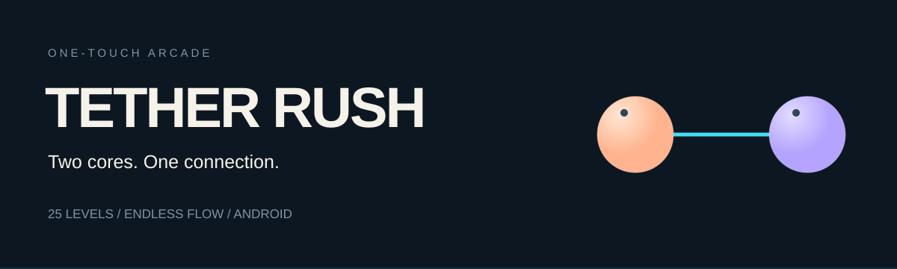
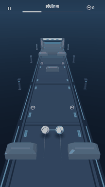
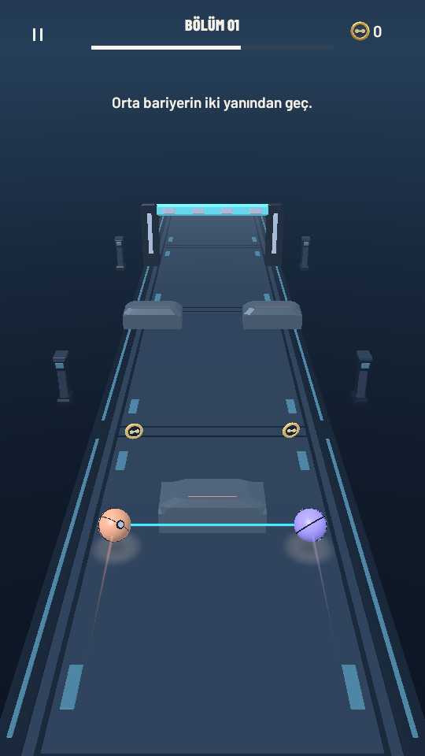
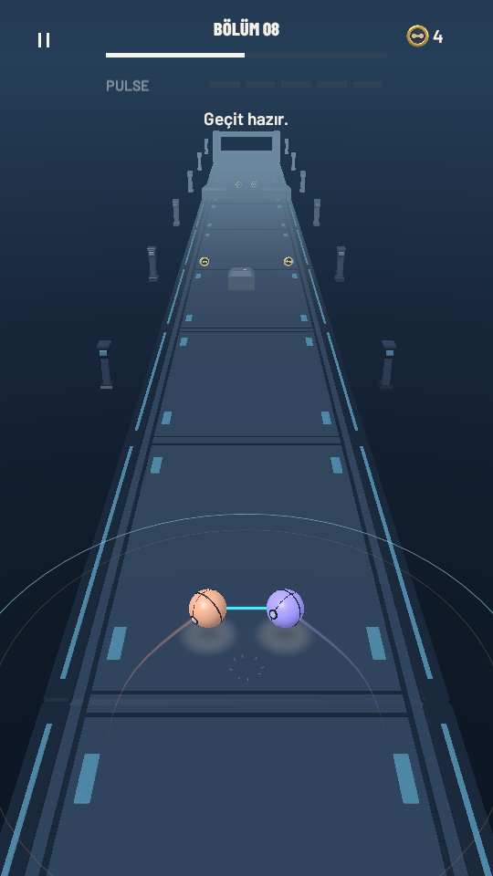
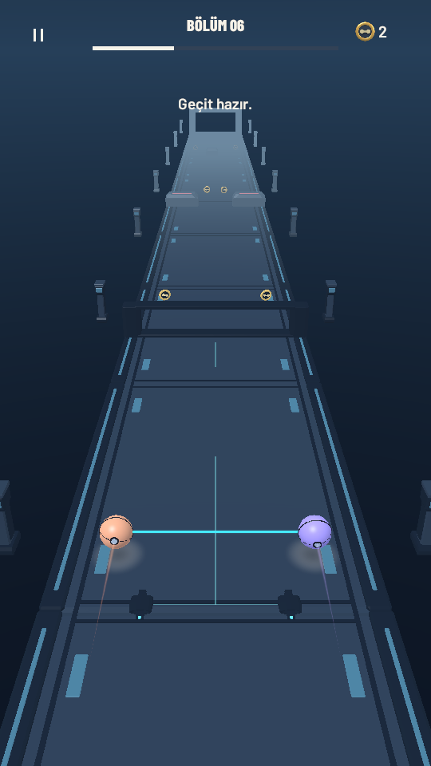
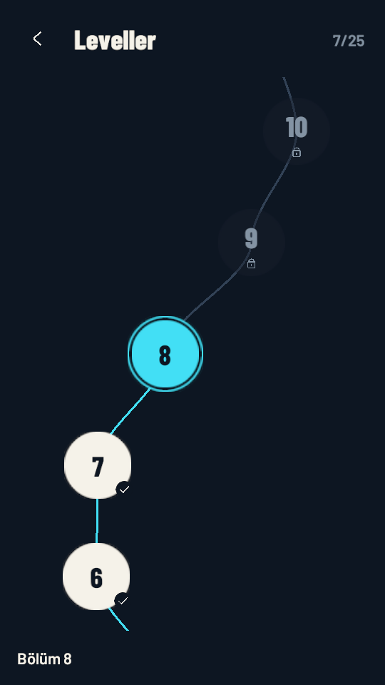

# Tether Rush

**One touch. Two cores. Every gap is a decision.**

A 3D arcade runner for portrait Android phones, built with Unity and C#. Hold to spread two connected cores apart; release to bring them together. Guide the energy tether through pickups, thread the cores around hazards, and time a charged Pulse to open the way ahead.

**Unity 6 · C# · URP · Blender · Android / Portrait**

  

▶ **[Watch / download the 15-second trailer · MP4](Docs/Portfolio/Media/trailer.mp4)**

*Real Unity Editor gameplay · 540 × 960 · 30 fps. Three continuous five-second shots, captured at normal game speed using scripted inputs. Original music and event-timed sound effects are mixed for the edit.*

## Gameplay

- **One-touch control:** two cores expand and contract symmetrically around a shared center during automatic forward motion.
- **Two ways to collect:** the tether gathers energy; the cores collect gold bonus coins. Contact between either core and a lethal obstacle ends the run.
- **Release-to-Pulse:** release at full energy to trigger one short-range Pulse against specially marked targets. Timing matters; ordinary hazards remain dangerous.
- **Interactive routes:** spread the tether across conductive relay pads to open a linked gate, or use a charged Pulse to retract an amber moving lock.
- **25 levels + Endless Flow:** unlock a numbered level map, replay completed courses, or chase a local high score as Endless Flow gradually increases its pace up to a speed cap.

## In-game screenshots

<table>
  <tr>
    <td align="center"> One-touch obstacle navigation</td>
    <td align="center"> Charged Pulse timing</td>
  </tr>
  <tr>
    <td align="center"> Tether relay interaction</td>
    <td align="center"> 25-level progression</td>
  </tr>
</table>

[Main menu screenshot](Docs/Portfolio/Media/menu.png)

## Technical highlights

Built in **Unity 6000.3.19f1** with **C#**, **URP 17.3.0**, and **Input System 1.19.0**. Blender source models are kept separately from the controlled FBX exports used in Unity.

- Shared gameplay rules across authored levels and streamed endless course patterns.
- Persistent level progression, best scores, and audio settings, including migration from the earlier five-level save format.
- Automated EditMode and PlayMode coverage for gameplay, input transitions, progression, save migration, UI, and rendering behavior.
- Measured optimization of HUD text updates, static menu preview rendering, collision candidate filtering, and visual-effect updates.

In controlled, matched Unity Editor/Mono routes, optimization reduced **GC.Alloc event counts by 97–99%** and **mean simulation-step processing time by 43–61%**. These figures measure Editor workloads; they are not mobile FPS, allocation-byte, or peak-memory results. See the [measurement method and limits](Docs/QA/OPTIMIZATION_VALIDATION.md).

## Development status

**Playable development build: 0.9.0 (10).** The current validation record reports **256/256 gameplay and regression checks passing**, successful Windows and Android builds, and a verified Android APK signature.

Physical Android device validation is pending, including touch feel, frame rate, thermal behavior, screen cutouts, and app lifecycle checks. The project is not presented as a released store title. Current evidence and remaining checks are tracked in the [project status](Docs/Planning/PROJECT_STATUS.md).

## Open and play

1. Open the repository folder in **Unity 6000.3.19f1** and let package resolution and import finish.
2. Open `Assets/TetherRush/Scenes/MainMenu.unity`. If the scene is missing, run **Tether Rush → Prepare Project**.
3. Set the Game view to **9:16** and enter Play Mode. Choose **Leveller** for the level map or **Sonsuz Akış** for Endless Flow.
4. **Hold the left mouse button or Space to spread; release to contract.** A release at full energy also fires a Pulse. On mobile, use one touch in the play area.

For the full Turkish development guide, see [Geliştirme ve test rehberi](Docs/DEVELOPMENT_TR.md). For repeatable test/build commands, see [Tools/Unity.ps1](Tools/Unity.ps1). Android builds require Unity Android Build Support, SDK/NDK, and OpenJDK; package versions are locked in [Packages/packages-lock.json](Packages/packages-lock.json).

## Project documentation

[Design decisions](Docs/Planning/DECISIONS.md) · [Development workflow](Docs/Planning/WORKFLOW.md) · [Art pipeline](Docs/Art/ART_PIPELINE.md) · [Original audio](Docs/Audio/AUDIO_ASSETS.md) · [Optimization validation](Docs/QA/OPTIMIZATION_VALIDATION.md)

Media capture and encoding details: [portfolio media notes](Docs/Portfolio/MEDIA_NOTES.md).
